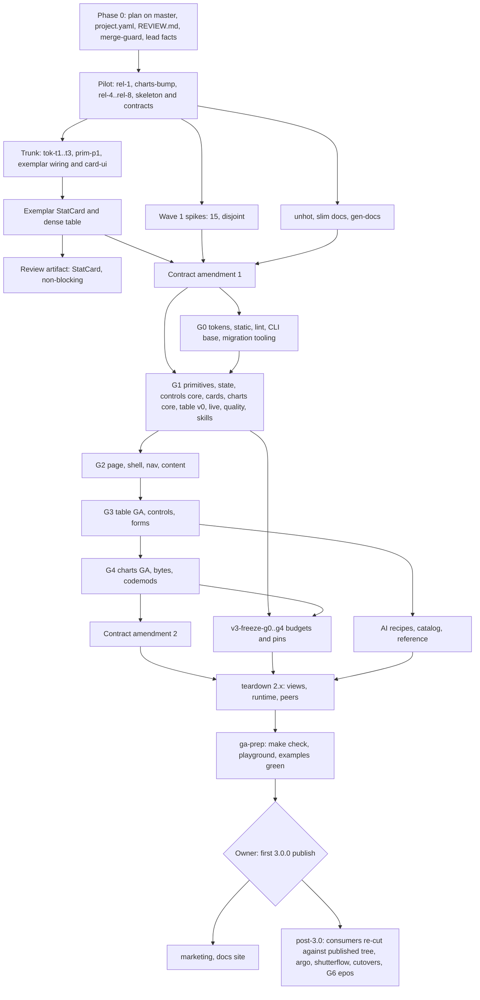

# Basalt UI v3: implementation plan

Date 2026-11-09, revised same day ([PLAN-REVISION](PLAN-REVISION.md)). Authorises no release. Run after [PHASE-0](PHASE-0.md).

**v3 ships as 204 basalt-ui Issues in six waves, run from `docs/plan.yaml` (design record: `docs/v3/issues/index.json`), rewritten in place on master as 3.0; 74 held rows for consumers wait in `wave: "post-3.0"`.** One gate holds the build: the pilot chain (`rel-1` to `rel-7`) and the contract amendment that folds 15 spike results into the signed text. The owner's four decisions are made; verdict rows build non-blocking review artifacts. The one release is `v3-ga`, the owner's go when `make check`, `apps/playground` and `examples/*` are green. The DAG is acyclic, every concurrent same-repo pair owns disjoint paths, and `bun /tmp/v3-validate-issues.ts` exits 0 against this tree.

**Rule: held rows are re-cut before filing.** A held row (`held: true`, `wave: "post-3.0"`) is re-written against the published 3.0.0 tree before it is filed. Its facts still say `next.N`, `fleet-status`, and floors: stale by design until the re-cut. No held row files until `npm view basalt-ui version` prints 3.0.0.

## Reading order

1. [DIRECTION.md](DIRECTION.md): the verdict, the master table of what we implement, guarantee, teach and leave open, section 6 refusals, the DPO table.
2. [ARCHITECTURE.md](ARCHITECTURE.md): layers, the eight-verb CLI, contract files, peers, falsifiers.
3. `concepts/*.md`: one per lane; each Issue's `concept` cites the section.
4. This page, then [PHASE-0.md](PHASE-0.md): what lands before the first `rd issue`.
5. `issues/index.json` and `issues/<group>/<key>.json`: the Issue list and its facts.
6. [BRIEF.md](BRIEF.md) Owner clarifications when a row looks arguable.

`concept` citations rule when two sources disagree: `DIRECTION` > `ARCHITECTURE` > concepts > this plan.

## Phases and gates

| Phase                  | Waves       | Ends when                                                                                             | Decider                                                |
| ---------------------- | ----------- | ----------------------------------------------------------------------------------------------------- | ------------------------------------------------------ |
| 0 Prepare              | none        | Plan on master, `project.yaml` `leads: 1`, `REVIEW.md`, `make merge-guard`, lead facts in `AGENTS.md` | Orchestrator inline                                    |
| 1 Pilot                | 1           | `rel-1`..`rel-7` merged: `make release-dry` computes `3.0.0`, gate refuses it without `GA=1`          | Lead high                                              |
| 2 Exemplar and spikes  | 1           | Exemplars and 15 spikes closed; `v3-contract-amendment-spikes` merged                                 | Evidence; owner reviews the artifact later             |
| 3 Layers               | 2-3         | `v3-freeze-g0`..`g3` merged; AI recipes; G4 layer                                                     | Lead high; spikes decide                               |
| 4 Teardown and GA prep | 4           | `v3-freeze-g4`, teardown, `v3-ga-prep`: GA checks green on master                                     | Lead high                                              |
| 5 GA                   | 5           | `npm view basalt-ui dist-tags.latest` prints `3.0.0`                                                  | Owner runs the runbook; go asked when checks are green |
| 6 Post GA              | 6, post-3.0 | Docs site rebuilt; consumers (held rows) re-cut and migrated; G6 epos                                 | Owner; epos follows employer process                   |

G-numbers are layer build order, not consumer gates (`concepts/migration-release.md` section 5). Rows order only by real code dependency; `consumerGate` no longer gates and is `null` on every basalt-ui layer row.

| Layer                        | Freeze row (budgets, pins) | GA check                                                                        |
| ---------------------------- | -------------------------- | ------------------------------------------------------------------------------- |
| G0 tokens, lint, CLI base    | `v3-freeze-g0`             | Layer budgets                                                                   |
| G1 parts                     | `v3-freeze-g1`             | Layer budgets, pins                                                             |
| G2 page, shell, content      | `v3-freeze-g2`             | Layer budgets, pins                                                             |
| G3 table GA, controls, forms | `v3-freeze-g3`             | Layer budgets, pins                                                             |
| G4 charts GA, bytes          | `v3-freeze-g4`             | Layer budgets                                                                   |
| GA                           | `v3-ga-prep`, `v3-ga`      | `make check`, playground, `examples/*` green on master; required-peer set empty |

G5 work (argo, shutterflow) and G6 (epos) are held rows, after `v3-ga`. A consumer row is held even when its layer exists, because no consumer can install v3 before 3.0.0 is published.

Device and owner rows, never filed: iOS Drawer (M1), VoiceOver phone table (M6, table S1), `fetch` SSE on iOS (M5, live P2), Spec 523.

## Waves and parallelism

Waves come from `after` edges only: wave 1 is what can start now plus spikes that can overturn the design; a later wave is its dependencies' wave, and the dependents of a later spike, `v3-contract-amendment-late`, `v3-ga-prep` or `v3-ga` sit one wave after (so a spike verdict or a GA check is on master before they file). Widths come from the validator's antichain over `index.json`. Wave width far exceeds lead capacity, so the factory's lead queue throttles. `project.yaml leads` sets the ceiling per repo; this plan runs at `leads: 4` (it was 1, then 3), and six is the factory ceiling across repos (2 leads per account, 3 Max accounts).

| Wave     | Issues (basalt-ui / consumer) | Widest antichain | Max parallel leads                                         | Serial points                                                                                                                           |
| -------- | ----------------------------- | ---------------- | ---------------------------------------------------------- | --------------------------------------------------------------------------------------------------------------------------------------- |
| 1        | 47 / 0                        | 22               | 4 (the export-surface shard keeps leads off one JSON file) | `rel-1`, `charts-bump`, `rel-4` to `rel-7`; `tok-t1`..`tok-t3`; `prim-p1` chain; exemplar; `v3-contract-amendment-spikes`               |
| 2        | 120 / 0                       | 41               | 4                                                          | `gr-1` to `gr-4`; `sk-2` to `sk-5`; `sk-6` to `sk-8`, `cli-sibling`; `shell-i1`; `table-t0` to `t2`, the G1 spikes, `spike-shell-frame` |
| 3        | 32 / 0                        | 12               | 4                                                          | `shell-i3` to `i10`; `table-t3` to `t5`; `ctl-6`, `ctl-8`, `state-4`; `freeze-g0`..`g3`; `contract-amendment-late`; AI recipes          |
| 4        | 5 / 0                         | 1                | 1                                                          | `freeze-g4`, teardown chain (three rows), `ga-prep`                                                                                     |
| 5        | 1 / 0                         | 1                | Owner                                                      | `v3-ga`: the owner's go, the only release                                                                                               |
| 6        | 3 / 0                         | 2                | 1                                                          | Marketing, filed after 3.0.0 is on `latest`                                                                                             |
| post-3.0 | 5 / 69                        | held             | re-cut first                                               | Held consumer rows, sibling apps, argo ledger, cutovers; G6 epos                                                                        |

Landing serialises on a 17-minute `ci.yml`: `make merge-guard` refuses a red master, not a running one, so concurrent leads pay only on disjoint lanes. Critical path: 32 Issues, down from 40 (`rel-1`, `charts-bump`, `rel-4` to `rel-7`, `tok-*`, `prim-p1`, exemplar, the amendment, `ctl-1` to `ctl-6`, `freeze-g3`, `freeze-g4`, teardown, `ga-prep`, `ga`, marketing). The cut comes from dropped `after` edges that only ordered, not fed (the freeze chain, `sk-5` off `sk-3`, `shell-i9` off `cli-sibling`, the amendment off nine rows), from four splits that let dependents start on the half they use (`tok-t4a-names`, `table-t2a-parts`/`t2b-tiers`, `state-4a-controls`/`4b-recipes`, `shell-i7a-innernav`/`i7b-settings`; `st-2` folds into `tok-t4-cli`) and from `v3-shard-export-surface`, which replaces the one `export-surface.json` with a shard per subpath so parallel Issues stop colliding on it. `v3-ga-prep` now waits for every row that used to gate GA through a freeze, so no gate is lost. Rows in `post-3.0` extend it after GA.

## Group DAG

## Seat, effort, [opus]

Every filed Issue runs one `lead` at high effort. The lead is the only seat that ships, reviews and verifies, so "medium" or "Opus for 2-3" in older concept text is not a filing option. Seats are `roles.json` names; model ids live in `agw routes` only. Review tier comes from `REVIEW.md`: docs `none`, default `light`, deep on `scripts/release.sh`, `.github/**`, `.releaserc.json`, `packages/basalt-ui/src/lint/**`.

**A decision the lead would need more than its tier for is written into the Issue facts first.** Where the logic is novel and no fact can settle it, the row carries an `opus` reason in the index and the facts: the lead may spawn one `@implementer` tagged `[opus: <reason>]` for that one file group. That is 19 of 204 non-held Issues.

| Lane     | Folder                                                                       | Concept                              | Why the seat and effort fit                                                                                                  | `[opus]` rows and why                                                                                    |
| -------- | ---------------------------------------------------------------------------- | ------------------------------------ | ---------------------------------------------------------------------------------------------------------------------------- | -------------------------------------------------------------------------------------------------------- |
| A        | `src/tokens`, `src/css`                                                      | tokens-visual, static-framework-free | Generated palette behind gates and fixtures                                                                                  | None                                                                                                     |
| B        | `src/ui`, `src/cli/{eject,merge}`, `src/vite`                                | primitives-distribution              | Port plus guards; each primitive is mechanical                                                                               | `prim-p1-gen`, `prim-p1-core`, `prim-p7`, `p8`, `p9`: generator, three-way eject merge, build-time gates |
| C        | `src/core/{persisted,external-field,notify}`, `src/data`                     | state-persistence-forms              | Golden fixtures pin behaviour                                                                                                | `spike-synced`, `state-3`: conflict protocol                                                             |
| D        | `src/router/controls`, `src/controls`                                        | controls-url-state                   | Golden URLs pin the grammar                                                                                                  | `ctl-2`, `ctl-3`: branded codecs, three-level state                                                      |
| E        | `src/charts`, `src/cards`                                                    | charts-cards-kanban                  | Ported suites                                                                                                                | `charts-1`: replaces d3-scale, plot context                                                              |
| F        | `src/table`                                                                  | data-table                           | Invariants as public-DOM tests                                                                                               | `table-t1a`, `t1b`: TanStack v9 feature composition                                                      |
| G        | `src/page`, `src/shell`, `src/router/nav`                                    | shell-nav-router                     | Layout suite ports from 2.x                                                                                                  | `shell-i2`, `i3`, `i3b`: typed projection, claims and docking                                            |
| H        | `src/content`, `src/ai`, `src/page/{prose,callout,toc,article-layout,mdx}`   | ai-mdx                               | Mostly recipes                                                                                                               | `ai-i4`: schema-driven catalog with limits                                                               |
| I        | `src/lint`, `configs`                                                        | guardrails                           | Rule table, fixtures per form                                                                                                | `gr-1`: rule factory every rule inherits                                                                 |
| J        | `agent/**`, `src/cli/{init,sync,doctor,shot,lint,migrate}`, `gen-docs`       | skills-agent-layer                   | Doc and CLI generation                                                                                                       | None                                                                                                     |
| K        | `src/testing`, `tests/quality`, `scripts/check-budgets`                      | quality-contract                     | Matrices, each assertion with a seeded offender                                                                              | None                                                                                                     |
| L        | `src/core/channel.ts`, `src/data/live`, live page parts                      | live-realtime                        | P0-P11 fixtures                                                                                                              | None                                                                                                     |
| M        | `tools/migrate-v3`, `migrations/`, release scripts, freeze budgets, teardown | migration-release                    | Release gates deep-reviewed; codemods tested on fixtures                                                                     | `contract-amendment-spikes`, `-late`: signed contract text                                               |
| consumer | Consumer repos                                                               | migration-release 5, 6               | Each repo's own `project.yaml`; a gap is a `friction:` line, not a basalt patch                                              | None                                                                                                     |
| owner    | `v3-ga`, `v3-sf-cutover` (held), `v3-verdict-argo-ledger` (held)             | as cited                             | Owner-run, never filed; the orchestrator holds rows after them. Verdict rows left this lane (lane K, non-blocking artifacts) | None                                                                                                     |

Sizes follow `ext-factory`: at most 15 files and 1,500 lines per Issue, one lead, one PR; `l` only by recorded exception: `rel-7-skeleton` (stubs), consumer one-PR cutovers (`migration-release` 6 exception 5), and `teardown-*`, where a pure deletion or a verbatim move counts zero authored lines.

## Orchestrator, `@implementer`, factory

| Work                                                                            | Lane                                                | Why                                                                                                                         |
| ------------------------------------------------------------------------------- | --------------------------------------------------- | --------------------------------------------------------------------------------------------------------------------------- |
| Phase 0 files, doctrine, contract text, owner decisions, filing and re-planning | Orchestrator inline                                 | Editorial, novel; the owner iterates in the live tree                                                                       |
| Mechanical edits of those files, or the plan and `index.json`                   | `@implementer`                                      | Same live tree, disjoint file group, briefed fully                                                                          |
| Everything in this plan that ships on its own                                   | Factory Issue                                       | The lead builds, reviews, ships and verifies; a lead reads the default branch only                                          |
| Inside one Issue                                                                | The lead's own `Explore` and `@implementer`         | Built into standing orders; `[opus: <reason>]` only where the row names it                                                  |
| One indivisible sweep (a codemod or a pure-delete)                              | One Issue, lead may use workers on disjoint folders | N Issues would be N conflicting PRs on the same imports                                                                     |
| Owner rows (`filing: owner-run`)                                                | Owner session                                       | `v3-ga` (the only release row, owner's go at green GA checks); held `v3-verdict-argo-ledger`, `v3-sf-cutover`, `v3-g6-epos` |

## Filing recipe

`docs/plan.yaml` is what runs. The factory files a row as an Issue when its `after` rows are done; `factory project show basalt-ui` shows each row's state. Rows for the 46 Issues already filed are adopted (`key` + `issue`). `docs/v3/issues/` stays the design record, and `plan.yaml` wins on conflict. "Wave" only describes depth in the `after` graph; it is not a filing step.

- **Facts.** The server refuses a plan file over 64 KiB, so a normal row's facts are only `brief: <path>` of its file under `docs/v3/issues/` on master; `AGENTS.md` ("Factory leads (v3)") tells the lead how to read it. `v3-freeze-g2` also carries a `note` about the conditional `v3-flags-delete-g2`.
- **Not in `plan.yaml`.** Held rows are re-cut and added after 3.0.0 is published. Owner-run rows (`v3-ga`, the held verdict and cutover rows) are never filed. `v3-flags-delete-g2` (only when `docs/v3/spikes/epos-bridge-probe.md` says `Flags: delete-at-G2`) and `v3-marketing-docs-site` with its dependents `v3-marketing-recipes` and `v3-marketing-migration` (owner-filed once `npm view basalt-ui dist-tags.latest` prints `3.0.0`) are added by hand.
- **Contract amendment.** `v3-contract-amendment-spikes` (adopted Issue 603) may edit later `plan.yaml` rows whose facts its amendment invalidates.
- **Priority.** `factory issue prio <id> 9` for filed rows with `prio: 9` in the index (`v3-project-yaml-fanout`, exemplar rows, unhot rows).
- **The owner's go.** `v3-ga` files for nobody: when `v3-ga-prep` merges, the orchestrator asks the owner for the first publish, with `docs/v3/verdicts/ga-checks.md` as the evidence.

## Shared aggregator files

`owns` globs of concurrent Issues are pairwise disjoint. Aggregators that many Issues append to (`scripts/export-surface.json`, barrels, `slots.ts`, `no-restyle.generated.json`, `contract-pins.json`, `Makefile`, root and playground `package.json`, `tools/migrate-v3/run.ts`, `scripts/evidence/index.ts`) are not `owns` but `shared_append_only`: the Issue edits only its own lines; a rebase conflict keeps both sides or re-runs the named generator (`export-surface.mjs --update`, `gen-ui`, `bun install`); an Issue without the path never edits it. Dependency bumps go through one `v3-deps-*` Issue per wave. `v3-slim-repo-docs` writes this rule into `AGENTS.md`.

## Re-planning after a spike closes

Each spike writes `docs/v3/spikes/<name>.md` with a `Verdict:` line and the fallback its concept names. When a spike's Issue closes:

1. **Read the verdict before filing its dependents.** A spike's dependents are filed in the wave after it, so the verdict is always available.
2. **Confirmed:** nothing changes; file on.
3. **Refuted:** apply the concept's stated fallback to the rows that depend on it in `docs/v3/issues` (facts edit plus `index.json` if an `after` changes), in one docs PR, before filing those rows. Scope may shrink or a row may die; a row may not silently grow.
4. **Re-run the validator** (`bun /tmp/v3-validate-issues.ts` or its in-repo successor) and refuse to file on a non-zero exit.
5. **Amend the contract.** Wave 1 spike outcomes fold into `v3-contract-amendment-spikes`; later spikes (table-fit, table-bytes, control-home, shell-frame, Q2 map, Q3, Q5, F2, F3, S7, epos probe) fold into `v3-contract-amendment-late`. Neither row files until its inputs closed.
6. **Owner-only outcomes** (`Owner:` lines in `spike-thin-skill`, `spike-control-home`) wait for the owner before the rows after them file. Verdict rows are not owner-only outcomes: their review is non-blocking.

## Risks and estimate

| Risk                                                                       | Mitigation                                                                                                           |
| -------------------------------------------------------------------------- | -------------------------------------------------------------------------------------------------------------------- |
| A lead cannot be raised per Issue, so a hard call lands at the wrong level | Decisions written into facts first; 19 `[opus: reason]` workers; `contract-amendment-*` carry the contract calls     |
| Merge collisions at 3 leads on one repo                                    | Disjoint `owns`, `shared_append_only` rule, deps Issues per wave, `make merge-guard`, 17-minute CI watched           |
| `--after` chains release on a cancelled prerequisite                       | Freeze rows re-check budgets and pins; `make check` before every merge                                               |
| A consumer files before 3.0.0 exists                                       | Consumer rows are held until `v3-ga`; `held: true` skips the filing loop                                             |
| 2.x teardown breaks the v3 package mid-flight                              | Teardown after `freeze-g4` and the AI recipes, one chain, `release-migrating --check` plus `required-peers` as gates |
| Weekly Max window                                                          | `factory queue set pace` on the project near the owner's 90 % line; development stays on Max subscriptions only      |
| Argo or shutterflow friction after 3.0.0                                   | Held rows re-cut against the published tree; one disposition per friction row (`v3-verdict-argo-ledger`) after GA    |
| Owner bandwidth                                                            | One owner touch before GA: the first publish go. Review artifacts are read at his pace, nothing waits on them        |

**Estimate.** 202 factory Issues in basalt-ui before the post-3.0 held rows, the one conditional included (61 `s`, 137 `m`, 3 `l`), at 35, 100 and 180 minutes of lead time is about 273 lead-hours. At three concurrent leads that is about 91 hours of wall lead time; landing adds up to 50 hours of CI waits on the 204 merges, partly overlapping. Elapsed: two to four weeks, bound by the weekly Max window. The critical path is 40 Issues, so a second lead never buys back the freeze and GA chain. Consumer migrations (74 held rows) are not estimated here: they are re-cut after 3.0.0. Numbers assume the pilot proves the lane and that no spike refutes a concept wholesale.
