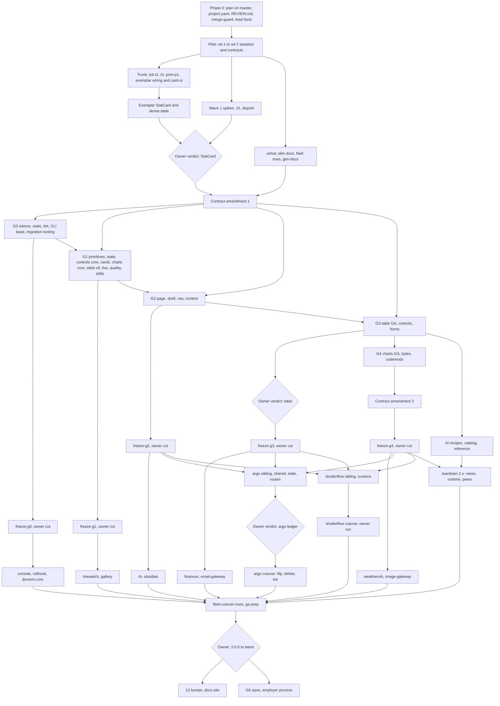

# Basalt UI v3: implementation plan

Date 2026-11-09. Authorises no release. Run after [PHASE-0](PHASE-0.md).

**v3 ships as 306 factory Issues in seven waves, filed wave by wave from `docs/v3/issues/index.json`.** Two gates hold everything: the pilot chain (`rel-1` to `rel-7`) and the StatCard verdict plus the contract amendment that folds 15 spike results into the signed text. Five owner cuts and five owner verdicts punctuate the middle; G6 epos closes it after the argo cutover. The DAG is acyclic, every concurrent same-repo pair owns disjoint paths, and `bun /tmp/v3-validate-issues.ts` exits 0 against this tree.

## Reading order

1. [DIRECTION.md](DIRECTION.md): the verdict, the master table of what we implement, guarantee, teach and leave open, section 6 refusals, the DPO table.
2. [ARCHITECTURE.md](ARCHITECTURE.md): layers, the eight-verb CLI, contract files, peers, falsifiers.
3. `concepts/*.md`: one per lane; each Issue's `concept` cites the section.
4. This page, then [PHASE-0.md](PHASE-0.md): what lands before the first `rd issue`.
5. `issues/index.json` and `issues/<group>/<key>.json`: the Issue list and its facts.
6. [BRIEF.md](BRIEF.md) Owner clarifications when a row looks arguable.

`concept` citations rule when two sources disagree: `DIRECTION` > `ARCHITECTURE` > concepts > this plan.

## Phases and gates

| Phase                 | Waves | Ends when                                                                                                                   | Decider                                        |
| --------------------- | ----- | --------------------------------------------------------------------------------------------------------------------------- | ---------------------------------------------- |
| 0 Prepare             | none  | Plan on master, `project.yaml` `leads: 1`, `REVIEW.md`, `make merge-guard`, lead facts in `AGENTS.md`, DPO 2, 3, 5 answered | Owner, orchestrator inline                     |
| 1 Pilot               | 1     | `rel-1`..`rel-7` merged: `make release-dry` prints `3.0.0-next.1`                                                           | Lead high; owner on `rel-2`, `rel-3`, `rel-4b` |
| 2 Exemplar and spikes | 1     | `v3-verdict-statcard` accepted; 15 spikes closed; `v3-contract-amendment-spikes` merged                                     | Owner's eye                                    |
| 3 Layers              | 2-4   | `v3-freeze-g0`..`g4` merged, owner cuts served, consumer cutovers green per `fleet-status`                                  | Gate rows below                                |
| 4 AI and apps         | 4-5   | `ai-*` recipes, argo and shutterflow sibling apps, cutovers, teardown                                                       | Owner on ledger and shutterflow cutover        |
| 5 GA                  | 6     | `npm view basalt-ui dist-tags.latest` prints `3.0.0`                                                                        | Owner runs the runbook                         |
| 6 Post GA             | 7     | Fleet on `^3.0.0`, docs site rebuilt, G6 epos started                                                                       | Owner; epos follows employer process           |

| Gate                         | Freeze row                                             | Owner cut                       | Consumers in the gate                                  | Signal                                                 |
| ---------------------------- | ------------------------------------------------------ | ------------------------------- | ------------------------------------------------------ | ------------------------------------------------------ |
| G0 tokens, lint, CLI base    | `v3-freeze-g0`                                         | `v3-release-g0-next`            | console, rollhook, jkrumm.com (six rows)               | `fleet-status --gate G0`; epos probe read-only         |
| G1 parts                     | `v3-freeze-g1`                                         | `v3-release-g1-next`            | linewatch, shutterflow gallery                         | `fleet-status --gate G1`; 40 linewatch test files      |
| G2 page, shell, content      | `v3-freeze-g2`                                         | `v3-release-g2-next`            | rb, basalt-ui-obsidian, argo and shutterflow scaffolds | 260 obsidian tests as Tree acceptance                  |
| G3 table GA, controls, forms | `v3-freeze-g3`                                         | `v3-release-g3-next`            | finances, email-gateway; argo and shutterflow bumps    | Table phone contract at 390                            |
| G4 charts GA, bytes          | `v3-freeze-g4`                                         | `v3-release-g4-cut`             | weatherorb, image-gateway; argo and shutterflow bumps  | 704 KiB `/map` bar                                     |
| G5 apps                      | `v3-argo-ledger` (four rows), `v3-verdict-argo-ledger` | none, sibling apps pin `next.N` | argo and shutterflow cutovers                          | One disposition per friction row; 53 e2e, 34 baselines |
| GA                           | `v3-ga-prep`                                           | `v3-ga`                         | every row above; teardown done                         | `fleet-status --ga`; required-peer set empty           |
| G6 epos                      | after GA and argo cutover                              | owner-started                   | epos-ai-teamchat-athena                                | Frozen install adds no unwanted peers                  |

Device and owner rows, never filed: iOS Drawer (M1), VoiceOver phone table (M6, table S1), `fetch` SSE on iOS (M5, live P2), Spec 523.

## Waves and parallelism

The widths come from the validator's antichain over `index.json`. Wave width far exceeds lead capacity, so the factory's lead queue throttles. `project.yaml leads` sets the ceiling per repo; six is the factory ceiling across repos (2 leads per account, 3 Max accounts).

| Wave | Issues (basalt-ui / consumer) | Widest antichain | Max parallel leads                                    | Serial points                                                                                                                                     |
| ---- | ----------------------------- | ---------------- | ----------------------------------------------------- | ------------------------------------------------------------------------------------------------------------------------------------------------- |
| 1    | 52 / 0                        | 22               | 1 until `v3-project-yaml-fanout`, then 3              | `rel-1` to `rel-7`; `tok-t1`..`tok-t3`; `prim-p1` chain; exemplar; `v3-verdict-statcard`; `v3-contract-amendment-spikes`                          |
| 2    | 103 / 6                       | 33               | 3 (4 when `factory read host` shows memory headroom)  | `gr-1` to `gr-4`; `sk-2` to `sk-5`; `sk-6` to `sk-8`, `cli-sibling`; `freeze-g0`, `release-g0-next`; `freeze-g1`, `release-g1-next`               |
| 3    | 37 / 2                        | 14               | 3                                                     | `shell-i1` to `i5`; `table-t0` to `t5`, `verdict-table`; `ctl-6`, `verdict-control-cue`; `verdict-shell`; `freeze-g2`, `freeze-g3` and their cuts |
| 4    | 14 / 32                       | 24               | basalt-ui 2, argo 3, shutterflow 3, others 1; 6 total | `argo-scaffold` to `argo-shell`, `sf-scaffold` to `sf-shell`, `freeze-g4`, `contract-amendment-late`                                              |
| 5    | 9 / 32                        | 18               | basalt-ui 1, argo 3, shutterflow 3, others 1; 6 total | `release-g4-cut`; teardown chain (three rows); argo ledger to cutover; shutterflow `sf-cutover` (owner)                                           |
| 6    | 3 / 0                         | 1                | 1                                                     | `fleet-cutover-rows`, `ga-prep`, `ga`                                                                                                             |
| 7    | 3 / 13                        | 15               | 1 per repo, 6 total                                   | Bumps and marketing filed only after 3.0.0 is `latest`; G6 epos starts after                                                                      |

Landing serialises on a 17-minute `ci.yml`: `make merge-guard` refuses a red master, not a running one, so concurrent leads pay only on disjoint lanes. Critical path: 54 Issues (`rel-1` through `tok-*`, `prim-p1`, exemplar, the amendment, `st-*`, `gr-*`, `sk-*`, `shell-i9`, `freeze-g2`, `argo-*`, the ledger, the cutovers, `ga`, marketing).

## Group DAG



## Seat, effort, [opus]

Every filed Issue runs one `lead` at high effort. The lead is the only seat that ships, reviews and verifies, so "medium" or "Opus for 2-3" in older concept text is not a filing option. Seats are `roles.json` names; model ids live in `agw routes` only. Review tier comes from `REVIEW.md`: docs `none`, default `light`, deep on `scripts/release.sh`, `.github/**`, `.releaserc.json`, `packages/basalt-ui/src/lint/**`.

**A decision the lead would need more than its tier for is written into the Issue facts first.** Where the logic is novel and no fact can settle it, the row carries an `opus` reason in the index and the facts: the lead may spawn one `@implementer` tagged `[opus: <reason>]` for that one file group. That is 19 of 306 Issues.

| Lane     | Folder                                                                     | Concept                              | Why the seat and effort fit                                                                                           | `[opus]` rows and why                                                                                    |
| -------- | -------------------------------------------------------------------------- | ------------------------------------ | --------------------------------------------------------------------------------------------------------------------- | -------------------------------------------------------------------------------------------------------- |
| A        | `src/tokens`, `src/css`                                                    | tokens-visual, static-framework-free | Generated palette behind gates and fixtures                                                                           | None                                                                                                     |
| B        | `src/ui`, `src/cli/{eject,merge}`, `src/vite`                              | primitives-distribution              | Port plus guards; each primitive is mechanical                                                                        | `prim-p1-gen`, `prim-p1-core`, `prim-p7`, `p8`, `p9`: generator, three-way eject merge, build-time gates |
| C        | `src/core/{persisted,external-field,notify}`, `src/data`                   | state-persistence-forms              | Golden fixtures pin behaviour                                                                                         | `spike-synced`, `state-3`: conflict protocol                                                             |
| D        | `src/router/controls`, `src/controls`                                      | controls-url-state                   | Golden URLs pin the grammar                                                                                           | `ctl-2`, `ctl-3`: branded codecs, three-level state                                                      |
| E        | `src/charts`, `src/cards`                                                  | charts-cards-kanban                  | Ported suites                                                                                                         | `charts-1`: replaces d3-scale, plot context                                                              |
| F        | `src/table`                                                                | data-table                           | Invariants as public-DOM tests                                                                                        | `table-t1a`, `t1b`: TanStack v9 feature composition                                                      |
| G        | `src/page`, `src/shell`, `src/router/nav`                                  | shell-nav-router                     | Layout suite ports from 2.x                                                                                           | `shell-i2`, `i3`, `i3b`: typed projection, claims and docking                                            |
| H        | `src/content`, `src/ai`, `src/page/{prose,callout,toc,article-layout,mdx}` | ai-mdx                               | Mostly recipes                                                                                                        | `ai-i4`: schema-driven catalog with limits                                                               |
| I        | `src/lint`, `configs`                                                      | guardrails                           | Rule table, fixtures per form                                                                                         | `gr-1`: rule factory every rule inherits                                                                 |
| J        | `agent/**`, `src/cli/{init,sync,doctor,shot,lint,migrate}`, `gen-docs`     | skills-agent-layer                   | Doc and CLI generation                                                                                                | None                                                                                                     |
| K        | `src/testing`, `tests/quality`, `scripts/check-budgets`                    | quality-contract                     | Matrices, each assertion with a seeded offender                                                                       | None                                                                                                     |
| L        | `src/core/channel.ts`, `src/data/live`, live page parts                    | live-realtime                        | P0-P11 fixtures                                                                                                       | None                                                                                                     |
| M        | `tools/migrate-v3`, `migrations/`, release scripts, teardown               | migration-release                    | Release gates deep-reviewed; codemods tested on fixtures                                                              | `contract-amendment-spikes`, `-late`: signed contract text                                               |
| consumer | Consumer repos                                                             | migration-release 5, 6               | Each repo's own `project.yaml`; a gap is a `friction:` line, not a basalt patch                                       | None                                                                                                     |
| owner    | Verdicts, owner cuts, `rel-3`, `rel-4b`                                    | as cited                             | Filed `kind: chore`; the lead asks through a factory Decision and closes on the owner's action, or verifies read-only | None                                                                                                     |

Sizes follow `ext-factory`: at most 15 files and 1,500 lines per Issue, one lead, one PR; `l` only by recorded exception: `rel-7-skeleton` (stubs), consumer one-PR cutovers (`migration-release` 6 exception 5), and `teardown-*`, where a pure deletion or a verbatim move counts zero authored lines.

## Orchestrator, `@implementer`, factory

| Work                                                                            | Lane                                                | Why                                                                                       |
| ------------------------------------------------------------------------------- | --------------------------------------------------- | ----------------------------------------------------------------------------------------- |
| Phase 0 files, doctrine, contract text, owner decisions, filing and re-planning | Orchestrator inline                                 | Editorial, novel; the owner iterates in the live tree                                     |
| Mechanical edits of those files, or the plan and `index.json`                   | `@implementer`                                      | Same live tree, disjoint file group, briefed fully                                        |
| Everything in this plan that ships on its own                                   | Factory Issue                                       | The lead builds, reviews, ships and verifies; a lead reads the default branch only        |
| Inside one Issue                                                                | The lead's own `Explore` and `@implementer`         | Built into standing orders; `[opus: <reason>]` only where the row names it                |
| One indivisible sweep (a codemod or a pure-delete)                              | One Issue, lead may use workers on disjoint folders | N Issues would be N conflicting PRs on the same imports                                   |
| Owner rows (`filing: owner-run`)                                                | Owner session                                       | A release is a decision; `v3-ga`, `v3-verdict-argo-ledger`, `v3-sf-cutover`, `v3-g6-epos` |

## Filing recipe

File wave by wave from `docs/v3/issues/index.json`, in index order (it is topologically sorted within each wave). Never file ahead of a closed previous wave: re-planning (next section) edits the rows after it.

For each row with `filing: factory` in the current wave:

```bash
# ISSUES=docs/v3/issues; KEY, REPO, TITLE, GROUP from the row
# Resolve each key in the row's "after" to its returned Issue id; skip closed ids and owner-run keys.
ids=()              # ids of open Issues the row waits for
for dep in "${after[@]}"; do
  [[ "${filing[$dep]}" == owner-run ]] && continue   # the orchestrator waits for it instead (see below)
  out=$(rd issue "${repo[$dep]}" "${title[$dep]}" --facts @"$ISSUES/${group[$dep]}/$dep.json" --key "$dep")
  id=$(echo "$out" | sed -n 's/.*"id": *\([0-9]*\).*/\1/p')   # rd prints the factory's answer; take the Issue id from it
  # --key is the idempotency: a replay returns the stored Issue and ignores --after.
  ids+=("$id")
done
rd issue "$REPO" "$TITLE" --facts @"$ISSUES/$GROUP/$KEY.json" --key "$KEY" $(printf -- '--after %s ' "${ids[@]}")
```

Rules that keep the recipe honest:

- **`--after` refuses a closed Issue id.** Drop dep ids that report closed, or filing fails for the wrong reason. Keep the replay that produced the id; it is idempotent.
- **`filing` in the index decides the path.** `factory`: this loop. `owner-run` (`v3-ga`, `v3-verdict-argo-ledger`, `v3-sf-cutover`, `v3-g6-epos`): never filed; the orchestrator holds every row after one until the owner confirms it done, then drops the key. `owner-filed` (`v3-argo-cutover-flip`, the 12 `v3-bump-*`, `v3-marketing-docs-site`): filed by the owner, `after: []`, after the verdict or after `npm view basalt-ui dist-tags.latest` prints `3.0.0`. `conditional` (`v3-flags-delete-g2`): filed only when `docs/v3/spikes/epos-bridge-probe.md` says `Flags: delete-at-G2`.
- **Priority.** After filing, `factory issue prio <id> 9` for every row with `prio: 9` (`v3-project-yaml-fanout`, exemplar rows, unhot rows).
- **Cross-repo edges.** A consumer row's `--after` may name a `basalt-ui` Issue id; consumers wait on the owner cut row, not the freeze, so a pin never points at an unpublished `next.N`.
- **Wave check.** `rd issues` lists every key once for the wave; `factory queue order` shows the wave's root rows first. A key that fails filing stops the wave: fix the facts, re-run the validator, resume; `--key` makes the replay safe.
- **Stale wording.** PHASE-0 step 7 names a flat `docs/v3/issues/<key>.json` path, and its last paragraph files all owner rows; this section is authoritative until PHASE-0 is amended.

## Shared aggregator files

`owns` globs of concurrent Issues are pairwise disjoint. Aggregators that many Issues append to (`scripts/export-surface.json`, barrels, `slots.ts`, `no-restyle.generated.json`, `contract-pins.json`, `Makefile`, root and playground `package.json`, `tools/migrate-v3/run.ts`, `scripts/evidence/index.ts`) are not `owns` but `shared_append_only`: the Issue edits only its own lines; a rebase conflict keeps both sides or re-runs the named generator (`export-surface.mjs --update`, `gen-ui`, `bun install`); an Issue without the path never edits it. Dependency bumps go through one `v3-deps-*` Issue per wave. `v3-slim-repo-docs` writes this rule into `AGENTS.md`.

## Re-planning after a spike closes

Each spike writes `docs/v3/spikes/<name>.md` with a `Verdict:` line and the fallback its concept names. When a spike's Issue closes:

1. **Read the verdict before filing its dependents.** A spike's dependents are filed in the wave after it, so the verdict is always available.
2. **Confirmed:** nothing changes; file on.
3. **Refuted:** apply the concept's stated fallback to the rows that depend on it in `docs/v3/issues` (facts edit plus `index.json` if an `after` changes), in one docs PR, before filing those rows. Scope may shrink or a row may die; a row may not silently grow.
4. **Re-run the validator** (`bun /tmp/v3-validate-issues.ts` or its in-repo successor) and refuse to file on a non-zero exit.
5. **Amend the contract.** Wave 1 spike outcomes fold into `v3-contract-amendment-spikes`; later spikes (table-fit, table-bytes, control-home, shell-frame, Q2 map, Q3, Q5, F2, F3, S7, epos probe) fold into `v3-contract-amendment-late`. Neither row files until its inputs closed.
6. **Owner-only outcomes** (`Owner:` lines in `spike-thin-skill`, `spike-control-home`) wait for the owner before the rows after them file.

## Risks and estimate

| Risk                                                                       | Mitigation                                                                                                           |
| -------------------------------------------------------------------------- | -------------------------------------------------------------------------------------------------------------------- |
| A lead cannot be raised per Issue, so a hard call lands at the wrong level | Decisions written into facts first; 19 `[opus: reason]` workers; `contract-amendment-*` carry the contract calls     |
| Merge collisions at 3 leads on one repo                                    | Disjoint `owns`, `shared_append_only` rule, deps Issues per wave, `make merge-guard`, 17-minute CI watched           |
| `--after` chains release on a cancelled prerequisite                       | `fleet-status` closes each gate, not `--after`; freeze rows re-check budgets and pins                                |
| Unpublished `next.N` stalls a consumer                                     | `v3-release-g*` cut row before every consumer; consumers stop with a signal if `npm view` fails                      |
| 2.x teardown breaks the v3 package mid-flight                              | Teardown after `freeze-g4` and the AI recipes, one chain, `release-migrating --check` plus `required-peers` as gates |
| Weekly Max window                                                          | `factory queue set pace` on the project near the owner's 90 % line; development stays on Max subscriptions only      |
| Argo or shutterflow friction stalls G5                                     | One disposition per friction row (`v3-verdict-argo-ledger`); a `friction:` line in a PR is signal, not a stop        |
| Owner bandwidth at the owner rows                                          | 12 owner touches named in the phase table; everything between them runs unattended                                   |

**Estimate.** 288 filed Issues, the one conditional included (73 `s`, 142 `m`, 3 `l` in basalt-ui; 10, 52, 8 in consumers), at 35, 100 and 180 minutes of lead time is about 405 lead-hours. At three concurrent leads on basalt-ui and three more across consumer repos, that is 70 to 90 hours of wall lead time; landing adds up to 60 hours of CI waits on the 218 basalt-ui merges, partly overlapping. Elapsed: three to five weeks, bound by the weekly Max window and the owner rows. The critical path is 54 Issues, so a second lead never buys back the verdict and freeze gates. Numbers assume the wave-1 pilot proves the lane and that no spike refutes a concept wholesale.
