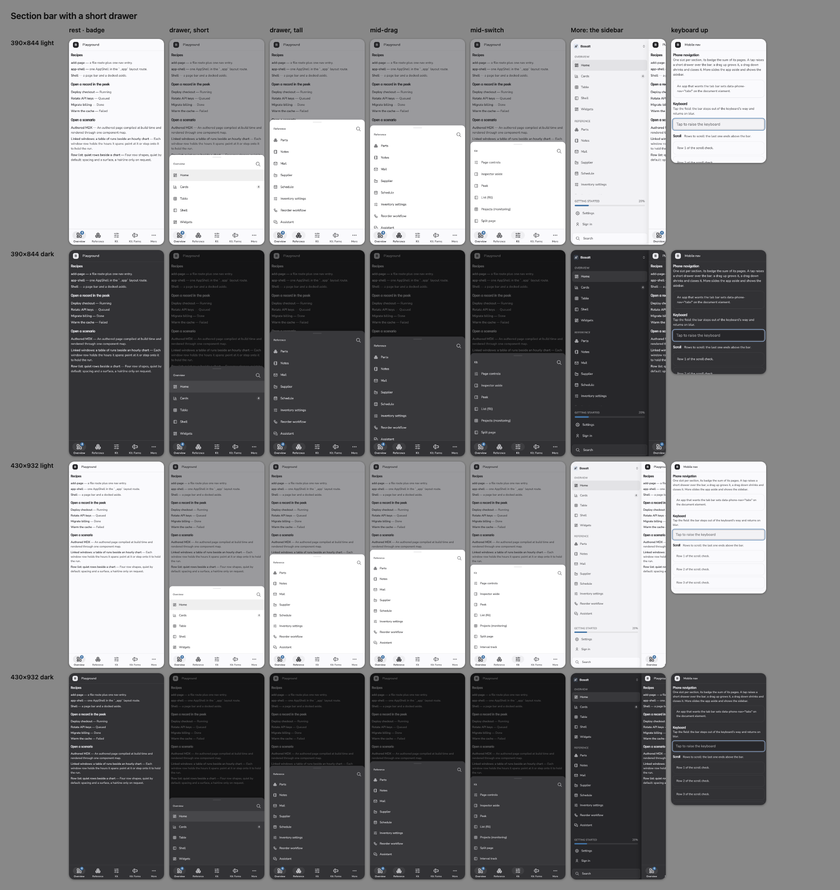

# Phone nav: the section bar with its short drawer (Issue 3246)

The owner's pick from Issue 3205 (B, the short drawer) is the phone default. Frames come from the
playground's real `defineNav`, shot headless at device scale 2 with touch on and a 34 px home indicator
stood in (`--shell-safe-bottom`). Mid-drag and mid-switch are shot with motion on, the rest settled.

## Contact sheet (390x844 and 430x932, light and dark)

## Single frames at 390x844

| State                                           | Light                                                          | Dark                                                         |
| ----------------------------------------------- | -------------------------------------------------------------- | ------------------------------------------------------------ |
| Short snap: Overview, five rows                 | [light](assets/phone-drawer-2026-11-24/short--light--390.png)  | [dark](assets/phone-drawer-2026-11-24/short--dark--390.png)  |
| Tall snap: Reference, eight rows                | [light](assets/phone-drawer-2026-11-24/tall--light--390.png)   | [dark](assets/phone-drawer-2026-11-24/tall--dark--390.png)   |
| Mid-drag: a finger 90 px up from the short snap | [light](assets/phone-drawer-2026-11-24/drag--light--390.png)   | [dark](assets/phone-drawer-2026-11-24/drag--dark--390.png)   |
| Mid-switch: Overview to Kit, 120 ms in          | [light](assets/phone-drawer-2026-11-24/switch--light--390.png) | [dark](assets/phone-drawer-2026-11-24/switch--dark--390.png) |

Reshoot: `bun --filter @basalt-ui/playground build`, then `bun apps/playground/scripts/phone-nav-frames.ts`
(writes `.evidence/phone-nav/`).
