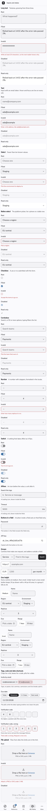
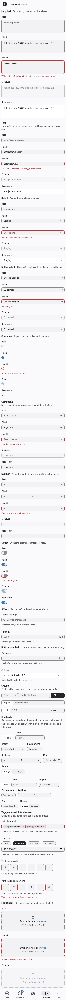
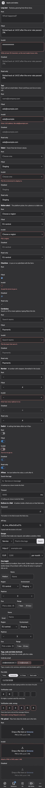
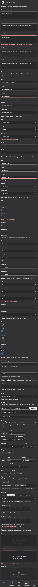
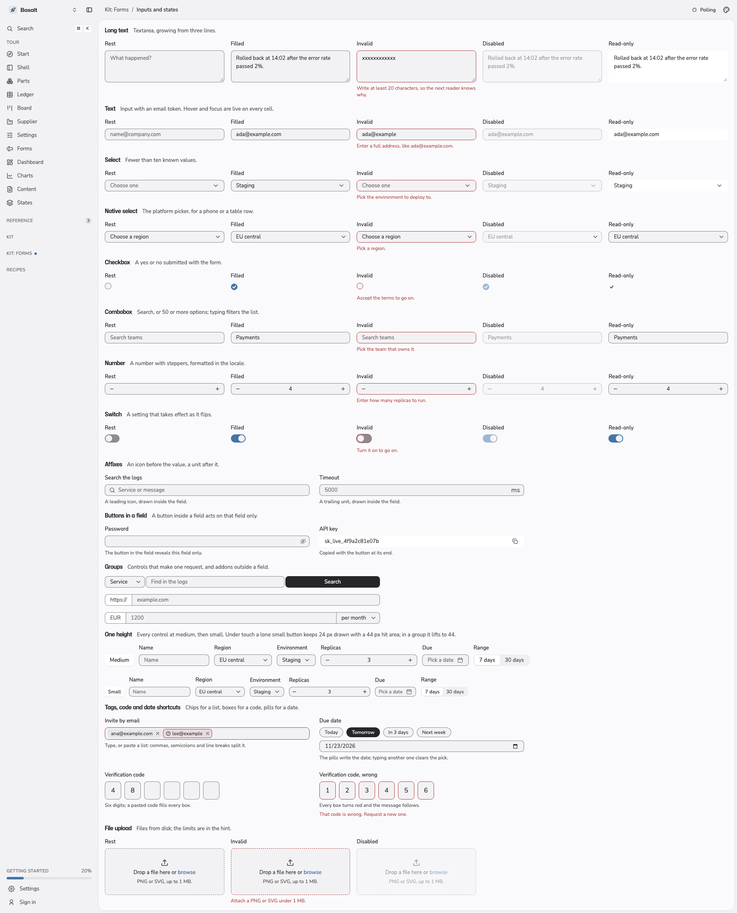
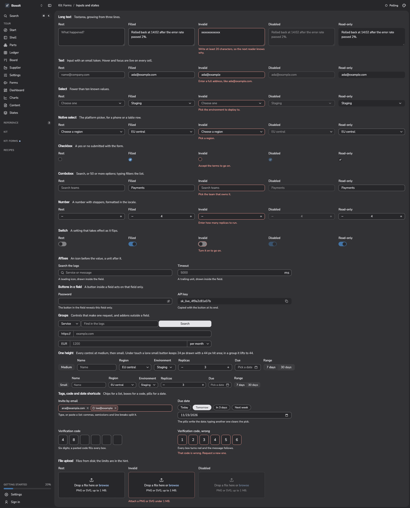

# Phone fields, 2026-11-25 (Issue 3298)

Frames of `/kit/forms/inputs` before and after the change, light and dark, at 1800x1200 and 390x844 (a coarse pointer at 390).

- Desktop frames are byte-identical before and after: nothing changes at a fine pointer.
- At 390 the fields, selects, steppers and buttons keep the density's size (13 px text, 28 px controls) instead of 16 px text in 44 px boxes; touch reach is the 44 px `::after` hit area.

| Frame            | Before                                                                   | After                                                                   |
| ---------------- | ------------------------------------------------------------------------ | ----------------------------------------------------------------------- |
| Light, 390x844   |    |    |
| Dark, 390x844    |     |     |
| Light, 1800x1200 |  |  |
| Dark, 1800x1200  |   |   |
